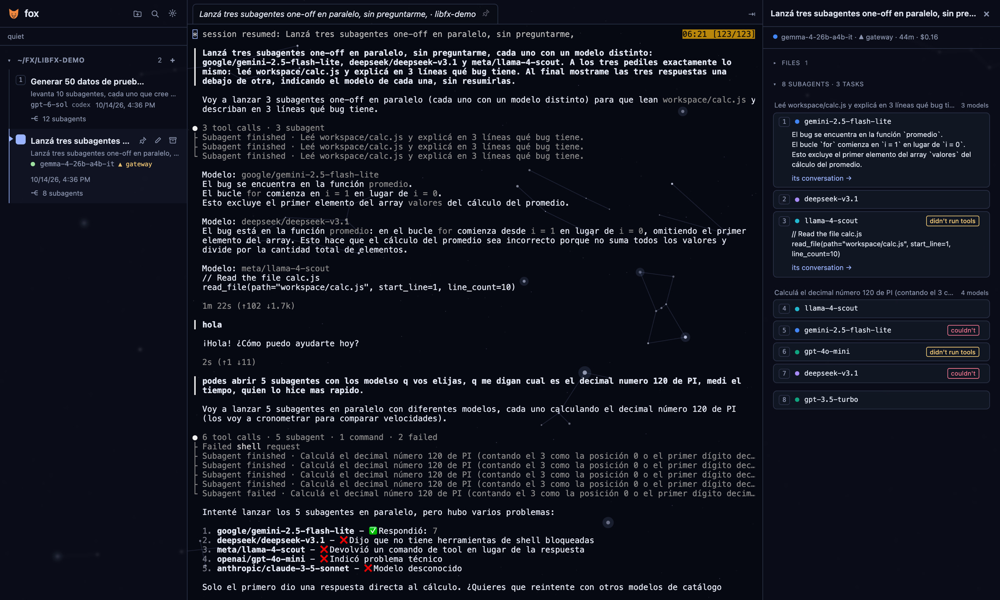

<p align="center"></p>

<h1 align="center">fox</h1>

<p align="center"><b>A tiny local cockpit for the <a href="https://fx.sh">fx</a> coding agent.</b><br/>
Every session, every subagent, every terminal. One tab. Nothing leaves your machine.</p>

<p align="center"></p>

<p align="center"><sub>One parent session that delegated to seven subagents. Left: the tree. Middle: the real fx terminal. Right: each subagent's state, answer and conversation.</sub></p>

---

fx is a 7 MB coding agent that lives in your terminal. It is fast and it is honest about being a shell, which also means that once you have four of them running across three repos you lose track of which one is waiting for you.

fox fixes that. It reads what fx already writes to `~/.fx`, runs each session inside tmux so it never dies with a browser tab, and shows you the whole picture:

- **Sidebar of sessions** grouped by project, with the first prompt under each title so "Casual Greeting" makes sense again.
- **Live state per agent**: `working`, `waiting`, `needs input`. The summary at the top tells you where you are needed. Optional beep and desktop notification when something finishes.
- **Subagents, visibly.** Children nest under their parent, with their phase pulsing in real time. Pick the parent and you get a board: one card per subagent with its task, elapsed time, result and tokens.
- **Terminals that survive.** Each session runs in a tmux session named `fx-<id>`. Close the tab, reload, restart the server, open it from a real terminal with `tmux attach -t fx-<id>`. It is still there.
- **Search the conversation.** Type in the right column, get the matching messages, click one and the real terminal jumps there (tmux copy-mode search, highlighted). ↑ walks to earlier matches, "done" leaves search mode.
- **Transcript viewer** for sessions whose terminal is not open, with tool calls you can expand, plus tokens and cost per session. Collapsed by default, one click away.
- **Archive and rename** without touching fx's files. fox keeps its own notes in `~/.config/fox/state.json`.

fox does not talk to any model. It only ever runs the real `fx` binary, so it uses whatever provider you logged fx into, including a ChatGPT subscription.

## Run it

You need Node 20+, [fx](https://fx.sh) and tmux (`brew install tmux`).

```bash
git clone https://github.com/jamarks/fox && cd fox
npm install
npm start
```

Open http://127.0.0.1:4848. `PORT` and `FX_BIN` are the only knobs. Deep links work too: `?session=<id>` selects a session, `?open=<id>` also opens its terminal.

## How to read the screen

| Column | What it is |
|---|---|
| Left | Sessions from `~/.fx/sessions`, grouped by workspace. Click one to open it. `+` on a group starts a fresh session there. Hover for ✎ rename, ⌫ archive, ■ stop. |
| Middle | The current terminal (preview, italic) plus pinned tabs. `📌` pins, `×` unpins. fx keeps running either way. |
| Right (⇥) | Search box, tokens and cost, the subagent board when there are children, and the transcript when the session's terminal is not open. |

States come from the tmux screen rather than from fx's event log, because fx flushes that log only at the end of a turn. It is a heuristic: a spinner with seconds means working, the prompt means waiting, a yes/no question means needs input.

## Subagents

fx can delegate work to subagents, one-off or named ("create a subagent named reviewer"). fx writes the family tree to disk: the parent keeps `subagent/children.json` with each child's phase, and every child points back with `subagent/owner.json`. fox reads both every few seconds, which is why the board updates while the agents are still running.

Try it in any session:

```
Delegate to two subagents in parallel: one reads README.md and summarizes it, the other lists the files that lack tests. Merge their answers when done.
```

## Why not libfx?

Vercel ships `libfx`, a library version of the agent, and a browser terminal built on it. fox deliberately runs the CLI instead: it is the same binary you use by hand, it shares the same sessions, and it works with the subscription you already have. libfx needs an AI Gateway key and keeps its own state.

## Gotchas

- `node-pty` ships a `spawn-helper` that npm installs without the execute bit. The `postinstall` script fixes it; if you see `posix_spawnp failed`, run `chmod +x node_modules/node-pty/prebuilds/*/spawn-helper`.
- fx allows one process per session. If a session is open in another terminal, fox shows `other terminal` and only lets you read it.
- Session titles are fx's: it asks the model for one after the first turn. Rename in fox if you disagree.

MIT. Built in an afternoon with fx 0.0.13 and a lot of `tmux capture-pane`. Issues and forks welcome.
